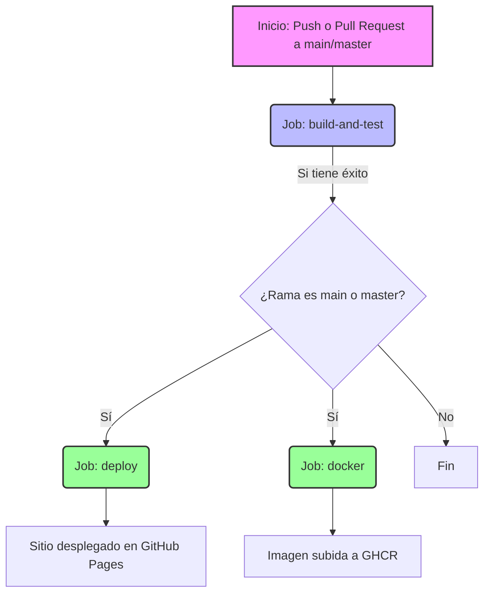

# 🚀 Guía de Despliegue en Producción

Esta guía te ayudará a desplegar tu aplicación Link-in-Bio usando herramientas gratuitas de GitHub: GitHub Actions (CI/CD), GitHub Container Registry y GitHub Pages.

## 📋 Requisitos Previos

- Cuenta de GitHub
- Repositorio público en GitHub (para GitHub Pages gratuito)
- Conocimientos básicos de Git

## 🏗️ Arquitectura de Despliegue

```
┌─────────────────┐    ┌──────────────────┐    ┌─────────────────┐
│   Código Local  │───▶│  GitHub Actions  │───▶│  GitHub Pages   │
│                 │    │     (CI/CD)      │    │   (Hosting)     │
└─────────────────┘    └──────────────────┘    └─────────────────┘
                              │
                              ▼
                       ┌──────────────────┐
                       │GitHub Container  │
                       │    Registry      │
                       │   (Docker)       │
                       └──────────────────┘
```

## 🔧 Configuración Paso a Paso

### 1. Preparar el Repositorio

1. **Crear repositorio en GitHub:**
   ```bash
   # Si aún no tienes un repositorio
   git init
   git add .
   git commit -m "Initial commit"
   git branch -M main
   git remote add origin https://github.com/TU_USUARIO/TU_REPOSITORIO.git
   git push -u origin main
   ```

2. **Actualizar configuración de Vite:**
   - Edita `vite.config.js` y cambia el nombre del repositorio:
   ```javascript
   // Línea 28: cambiar 'link-in-bio-website' por el nombre de tu repositorio
   config.base = '/TU_REPOSITORIO/'
   ```

### 2. Configurar GitHub Pages

1. **Ir a Settings del repositorio**
2. **Navegar a Pages (en el menú lateral)**
3. **Configurar Source:**
   - Source: `GitHub Actions`
   - ✅ No seleccionar "Deploy from a branch"

### 3. Configurar Permisos de GitHub Actions

1. **Ir a Settings → Actions → General**
2. **Workflow permissions:**
   - ✅ Seleccionar "Read and write permissions"
   - ✅ Marcar "Allow GitHub Actions to create and approve pull requests"

### 4. Configurar Variables de Entorno (Opcional)

1. **Ir a Settings → Secrets and variables → Actions**
2. **Agregar variables de repositorio:**
   ```
   VITE_APP_TITLE=Tu Nombre
   VITE_APP_DESCRIPTION=Tu descripción
   VITE_SOCIAL_INSTAGRAM=tu_usuario_instagram
   VITE_SOCIAL_TWITTER=tu_usuario_twitter
   VITE_SOCIAL_LINKEDIN=tu_usuario_linkedin
   VITE_SOCIAL_GITHUB=tu_usuario_github
   ```

### 5. Activar GitHub Container Registry

1. **Ir a Settings → Developer settings → Personal access tokens**
2. **Crear token con permisos:**
   - `write:packages`
   - `read:packages`
   - `delete:packages`

## 🚀 Proceso de Despliegue

### Despliegue Automático

Cada vez que hagas `push` a la rama `main`, se ejecutará automáticamente:

1. **Build y Test** (GitHub Actions)
   - Instala dependencias
   - Ejecuta linter
   - Ejecuta tests con cobertura
   - Construye la aplicación

2. **Deploy a GitHub Pages**
   - Despliega automáticamente a `https://TU_USUARIO.github.io/TU_REPOSITORIO/`

3. **Build Docker Image**
   - Construye imagen Docker optimizada
   - La sube a GitHub Container Registry
   - Disponible en `ghcr.io/TU_USUARIO/TU_REPOSITORIO:latest`

### Despliegue Manual

```bash
# 1. Hacer cambios en el código
git add .
git commit -m "Descripción de cambios"
git push origin main

# 2. El workflow se ejecuta automáticamente
# 3. Verificar en: https://github.com/TU_USUARIO/TU_REPOSITORIO/actions
```

## 🐳 Uso de Docker

### Ejecutar localmente con Docker

```bash
# Desarrollo
docker-compose up app

# Producción
docker-compose up production

# Testing
docker-compose up testing
```

### Usar imagen de GitHub Container Registry

```bash
# Descargar y ejecutar
docker run -p 80:80 ghcr.io/TU_USUARIO/TU_REPOSITORIO:latest
```

## 📊 Monitoreo y Verificación

### URLs Importantes

- **Aplicación en vivo:** `https://TU_USUARIO.github.io/TU_REPOSITORIO/`
- **GitHub Actions:** `https://github.com/TU_USUARIO/TU_REPOSITORIO/actions`
- **Container Registry:** `https://github.com/TU_USUARIO/TU_REPOSITORIO/pkgs/container/TU_REPOSITORIO`
- **Configuración Pages:** `https://github.com/TU_USUARIO/TU_REPOSITORIO/settings/pages`

### Verificar Despliegue

1. **Check GitHub Actions:**
   - ✅ Build and Test job completado
   - ✅ Deploy job completado
   - ✅ Docker job completado

2. **Check GitHub Pages:**
   - ✅ Sitio accesible
   - ✅ Assets cargando correctamente
   - ✅ Responsive design funcionando

3. **Check Docker Image:**
   - ✅ Imagen disponible en GHCR
   - ✅ Tags correctos
   - ✅ Tamaño optimizado

## 🔧 Troubleshooting

### Problemas Comunes

**1. Error 404 en GitHub Pages**
```bash
# Verificar que el base path en vite.config.js sea correcto
# Debe coincidir con el nombre del repositorio
config.base = '/nombre-exacto-del-repositorio/'
```

**2. Assets no cargan**
```bash
# Verificar que los paths relativos estén correctos
# GitHub Pages sirve desde subdirectorio
```

**3. Workflow falla en tests**
```bash
# Ejecutar tests localmente primero
npm run test
npm run lint
npm run build
```

**4. Docker build falla**
```bash
# Verificar que todos los archivos de configuración existan
# Especialmente vite.config.js
```

### Logs y Debugging

```bash
# Ver logs de GitHub Actions
# Ir a: https://github.com/TU_USUARIO/TU_REPOSITORIO/actions

# Ver logs de Docker localmente
docker-compose logs app

# Verificar build local
npm run build
npm run preview
```

## 💰 Costos y Límites

### GitHub Pages (Gratuito)
- ✅ Repositorios públicos: Ilimitado
- ✅ Ancho de banda: 100GB/mes
- ✅ Builds: 10 por hora

### GitHub Actions (Gratuito)
- ✅ Repositorios públicos: Ilimitado
- ✅ Repositorios privados: 2000 minutos/mes

### GitHub Container Registry
- ✅ Repositorios públicos: Gratis
- ✅ Almacenamiento: 1GB gratis
- ✅ Transferencia: 1GB gratis/mes
- 💰 Adicional: $0.25/GB almacenamiento, $0.50/GB transferencia

## 🎯 Optimizaciones Adicionales

### Performance
- ✅ Gzip compression habilitada
- ✅ Cache de assets estáticos (1 año)
- ✅ Bundle splitting (vendor/app)
- ✅ Lazy loading de componentes

### SEO
- ✅ Meta tags configurados
- ✅ Sitemap automático
- ✅ URLs amigables
- ✅ Open Graph tags

### Seguridad
- ✅ HTTPS por defecto
- ✅ Container no-root user
- ✅ Dependencias actualizadas
- ✅ Secrets management

## 📞 Soporte

Si tienes problemas:

1. **Revisa los logs** de GitHub Actions
2. **Verifica la configuración** de GitHub Pages
3. **Comprueba** que el repositorio sea público
4. **Consulta** la documentación oficial de GitHub

---

¡Tu aplicación Link-in-Bio está lista para producción! 🎉
