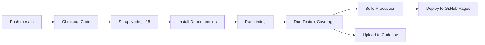

# Link in Bio Website - Rastro Sureño 🔗

Una aplicación web moderna de "link in bio" construida con React, TypeScript y Vite. Diseñada específicamente para **Rastro Sureño** - empresa patagónica especializada en quesos artesanales, mistelas y mermeladas.

> *"Prueba el Sur, la Patagonia te Invita a Descubrir"*

🌐 **Demo en vivo**: [https://d-araya.github.io/link_in_bio_web/](https://d-araya.github.io/link_in_bio_web/)

## 📋 Tabla de Contenidos

- [✨ Características](#-características)
- [🛠️ Tecnologías](#️-tecnologías)
- [📁 Estructura del Proyecto](#-estructura-del-proyecto)
- [🚀 Inicio Rápido](#-inicio-rápido)
- [💻 Desarrollo](#-desarrollo)
- [🧪 Testing](#-testing)
- [🐳 Docker](#-docker)
- [🚀 Deployment](#-deployment)
- [🧩 Componentes](#-componentes)
- [📋 Scripts Disponibles](#-scripts-disponibles)
- [🤝 Contribución](#-contribución)
- [🏢 Sobre Rastro Sureño](#-sobre-rastro-sureño)
- [📄 Licencia](#-licencia)
- [🆘 Soporte](#-soporte)

## ✨ Características

- 🚀 **React 19.1.1** con TypeScript para desarrollo type-safe
- ⚡ **Vite 7.1.2** para desarrollo rápido y builds optimizados
- 🎨 **Diseño responsive** que se adapta a todos los dispositivos
- 🧪 **Testing completo** con Vitest 3.2.4 y Testing Library
- 🐳 **Docker** con arquitectura multi-stage para desarrollo y producción
- 🔧 **ESLint 9.33.0** para mantener código limpio y consistente
- 📦 **GitHub Actions** para CI/CD automatizado
- 🌐 **Deploy automático** a GitHub Pages
- 🎯 **Componentes reutilizables** (Avatar, LinkButton)
- 📱 **Interfaz optimizada** para redes sociales y e-commerce
- ✨ **Efectos hover** y animaciones suaves
- 🔒 **Configuración de seguridad** con usuario no-root en Docker

## 🛠 Tecnologías

### Frontend
- **React 19.1.1** - Biblioteca de interfaz de usuario
- **TypeScript 5.8.3** - Superset tipado de JavaScript
- **Vite 7.1.2** - Build tool y dev server ultrarrápido
- **CSS3** - Estilos modernos con flexbox y animaciones
- **Font Awesome** - Iconos para redes sociales y enlaces

### Testing
- **Vitest 3.2.4** - Framework de testing rápido y moderno
- **React Testing Library 16.1.0** - Utilidades para testing de componentes React
- **@testing-library/jest-dom 6.6.3** - Matchers adicionales para DOM
- **@testing-library/user-event 14.5.2** - Simulación de eventos de usuario
- **jsdom 25.0.1** - Implementación de DOM para Node.js
- **@vitest/coverage-v8 3.2.4** - Cobertura de código
- **@vitest/ui 3.2.4** - Interfaz web para testing

### DevOps
- **Docker** - Containerización con multi-stage builds
- **Docker Compose** - Orquestación de servicios
- **Nginx Alpine** - Servidor web optimizado para producción
- **GitHub Actions** - CI/CD automatizado con deploy a GitHub Pages
- **GitHub Pages** - Hosting gratuito
- **GitHub Container Registry** - Registro de imágenes Docker
- **ESLint 9.33.0** - Linting y análisis estático de código
- **Node.js 20 Alpine** - Runtime para desarrollo

## 📁 Estructura del Proyecto

```
link_in_bio_web/
├── 📁 .github/                 # GitHub Actions workflows
│   └── workflows/
│       └── deploy.yml         # Pipeline CI/CD con testing y deploy
├── 📁 public/                 # Archivos estáticos
│   ├── logo_rastro_sureno.jpg # Logo de Rastro Sureño
│   └── vite.svg              # Favicon
├── 📁 src/                    # Código fuente
│   ├── 📁 components/         # Componentes React reutilizables
│   │   ├── Avatar.tsx        # Componente de avatar con efectos hover
│   │   ├── LinkButton.tsx    # Botón de enlace con iconos y animaciones
│   │   └── __tests__/        # Tests de componentes
│   ├── 📁 test/              # Configuración de testing
│   │   └── setup.ts         # Setup de Vitest con mocks
│   ├── 📁 __tests__/         # Tests de la aplicación
│   │   └── App.test.tsx     # Tests del componente principal
│   ├── App.tsx              # Componente principal con datos de Rastro Sureño
│   ├── main.tsx             # Punto de entrada
│   ├── index.css            # Estilos globales
│   └── vite-env.d.ts        # Tipos de Vite
├── 📄 Dockerfile             # Multi-stage build (dev, test, prod)
├── 📄 docker-compose.yml     # Orquestación de servicios
├── 📄 package.json           # Dependencias y scripts npm
├── 📄 tsconfig.json          # Configuración base de TypeScript
├── 📄 tsconfig.app.json      # Configuración específica de la app
├── 📄 tsconfig.node.json     # Configuración para Node.js
├── 📄 vite.config.ts         # Configuración de Vite con optimizaciones
├── 📄 vitest.config.ts       # Configuración de Vitest con coverage
├── 📄 eslint.config.js       # Configuración de ESLint
└── 📄 README.md             # Este archivo
```

## 🚀 Inicio Rápido

### Prerrequisitos

- **Node.js** 18+ (recomendado 20)
- **npm** o **yarn**
- **Docker** (opcional, para desarrollo con contenedores)
- **Git**

### Instalación

```bash
# 1. Clonar el repositorio
git clone https://github.com/D-Araya/link_in_bio_web.git
cd link_in_bio_web

# 2. Instalar dependencias
npm install

# 3. Iniciar servidor de desarrollo
npm run dev
```

🌐 **Aplicación disponible en**: http://localhost:5173

### Personalización

1. **Información de la empresa** → Edita `src/App.tsx`
2. **Logo/Avatar** → Reemplaza `public/logo_rastro_sureno.jpg`
3. **Enlaces sociales** → Modifica los componentes `LinkButton` en `App.tsx`
4. **Estilos y colores** → Actualiza los estilos inline según tu marca
5. **Configuración** → Opcional: crea `.env.local` para variables específicas

## 💻 Desarrollo

### Comandos de Desarrollo

```bash
# Desarrollo local (recomendado)
npm run dev

# Desarrollo con Docker
docker-compose up app

# Linting y verificación de código
npm run lint

# Preview del build de producción
npm run preview
```

🌐 **Servidor disponible en**: http://localhost:5173

### Características del Entorno

- ⚡ **Hot Module Replacement (HMR)** - Cambios instantáneos sin perder estado
- 🔄 **Auto-reload** - Recarga automática en cambios de archivos
- 🐛 **Source maps** - Debugging fácil con mapeo de código original
- 📱 **Responsive testing** - Vista optimizada para diferentes dispositivos
- 🔧 **TypeScript** - Verificación de tipos en tiempo real
- 🎨 **CSS-in-JS** - Estilos inline con IntelliSense
- 🔍 **ESLint** - Análisis de código en tiempo real

### Arquitectura de Componentes

```
src/
├── App.tsx              # 🏠 Componente principal
├── components/
│   ├── Avatar.tsx       # 👤 Imagen de perfil con efectos
│   └── LinkButton.tsx   # 🔗 Botones de enlaces con iconos
└── test/
    └── setup.ts         # ⚙️ Configuración de testing
```

## 🧪 Testing

### Comandos de Testing

```bash
# Desarrollo con tests en watch mode
npm run test

# Ejecutar todos los tests una vez
npm run test:run

# Interfaz web interactiva para tests
npm run test:ui

# Generar reporte completo de cobertura
npm run test:coverage

# Tests con Docker
docker-compose --profile testing run --rm test
```

### Stack de Testing

| Herramienta | Versión | Propósito |
|-------------|---------|----------|
| **Vitest** | 3.2.4 | Framework de testing rápido |
| **Testing Library** | 16.1.0 | Testing de componentes React |
| **Jest DOM** | 6.6.3 | Matchers adicionales para DOM |
| **User Event** | 14.5.2 | Simulación de interacciones |
| **jsdom** | 25.0.1 | Entorno DOM para Node.js |
| **Coverage v8** | 3.2.4 | Reportes de cobertura |

### Configuración Avanzada

- ✅ **Mocks automáticos**: `matchMedia`, `window.open`, `ResizeObserver`
- ✅ **Setup global**: Configuración en `src/test/setup.ts`
- ✅ **Umbrales de calidad**: 80% en todas las métricas
- ✅ **Interfaz web**: Dashboard interactivo para análisis
- ✅ **CI/CD integrado**: Tests automáticos en cada push

### Cobertura de Tests

```
- 🎯 **Branches**: 80%
- 🎯 **Functions**: 80%
- 🎯 **Lines**: 80%
- 🎯 **Statements**: 80%
```

## 🐳 Docker

### Arquitectura Multi-Stage
El proyecto utiliza un Dockerfile multi-stage optimizado:

1. **base**: Imagen base con Node.js y dependencias del sistema
2. **development**: Configuración para desarrollo con volúmenes
3. **testing**: Entorno aislado para ejecutar tests
4. **testing-coverage**: Tests con reportes de cobertura
5. **build**: Construcción optimizada para producción
6. **production**: Servidor Nginx con archivos estáticos

### Servicios Disponibles

```bash
# Desarrollo
docker-compose up app

# Testing
docker-compose --profile testing run test
docker-compose --profile testing run test-coverage
docker-compose --profile testing run test-watch

# Build de producción
docker-compose --profile build run build

# Producción con Nginx
docker-compose --profile production up production
```

### Gestión de Volúmenes
- **Código fuente**: Montado como volumen para desarrollo
- **node_modules**: Volumen persistente para mejor rendimiento
- **Builds**: Volúmenes para artefactos de construcción
```

Para más detalles, consulta [DOCKER.md](./DOCKER.md).

## 🚀 Deployment

### 🌐 GitHub Pages (Producción)

**URL en vivo**: [https://d-araya.github.io/link_in_bio_web/](https://d-araya.github.io/link_in_bio_web/)

#### Pipeline Automático CI/CD

Cada push a `main` ejecuta automáticamente:



```
#### Características del Deployment

- ✅ **CI/CD Automático** con GitHub Actions
- ✅ **Hosting Gratuito** en GitHub Pages
- ✅ **HTTPS** por defecto con dominio personalizado
- ✅ **Docker Registry** en GitHub Container Registry
- ✅ **Reportes de cobertura** con Codecov
- ✅ **Optimizaciones automáticas** (tree shaking, minificación)

#### URLs de Deployment

- 🌐 **Aplicación**: [https://d-araya.github.io/link_in_bio_web/](https://d-araya.github.io/link_in_bio_web/)
- 🔧 **Actions**: [GitHub Actions](https://github.com/D-Araya/link_in_bio_web/actions)
- 🐳 **Docker**: `ghcr.io/d-araya/link_in_bio_web:latest`
- 📊 **Repositorio**: [GitHub Repo](https://github.com/D-Araya/link_in_bio_web)
```

### 🚀 Otras Plataformas

#### Build de Producción

```bash
# Build local
npm run build

# Build con Docker
docker-compose --profile build run build

# Preview del build
npm run preview
```

#### Netlify
```bash
# Configuración
Build command: npm run build
Publish directory: dist
Node version: 18
```

#### Vercel
```bash
# Configuración automática
Framework: Vite
Build command: npm run build
Output directory: dist
```

#### Docker Producción
```bash
# Build optimizado con Nginx
docker build --target production -t rastro-sureno .
docker run -p 80:80 rastro-sureno

# Con Docker Compose
docker-compose --profile production up -d
```

## 🧩 Componentes

### 👤 Avatar

Componente de imagen de perfil con efectos visuales avanzados.

```typescript
interface AvatarProps {
  src: string;    // URL de la imagen
  alt: string;    // Texto alternativo para accesibilidad
  name: string;   // Nombre a mostrar debajo de la imagen
}
```

**Características:**
- ✨ **Efectos hover** con transformación scale
- 📱 **Responsive** - Se adapta a diferentes tamaños
- 🚀 **Lazy loading** - Carga optimizada de imágenes
- 🎨 **Bordes redondeados** con sombras elegantes
- ♿ **Accesibilidad** - Soporte completo para lectores de pantalla

### 🔗 LinkButton

Botón de enlace personalizable con iconos y animaciones.

```typescript
interface LinkButtonProps {
  href: string;           // URL del enlace
  icon: string;           // Clase del icono (Font Awesome)
  children: ReactNode;    // Texto del botón
  color?: string;         // Color del icono (opcional)
}
```

**Características:**
- 🎯 **Smart targeting** - Enlaces externos abren en nueva pestaña
- ✨ **Animaciones suaves** - Efectos hover con transformaciones
- 🎨 **Iconos Font Awesome** - Amplia biblioteca de iconos
- ♿ **Accesibilidad** - Labels ARIA y navegación por teclado
- 🎪 **Estilos consistentes** - Diseño uniforme en toda la aplicación

### 🎨 Personalización

```typescript
// Ejemplo de uso en App.tsx
<LinkButton 
  href="https://instagram.com/rastrosureno" 
  icon="fab fa-instagram" 
  color="#E4405F"
>
  Instagram
</LinkButton>
```

## 📋 Scripts Disponibles

| Script | Descripción | Uso |
|--------|-------------|-----|
| `npm run dev` | Inicia servidor de desarrollo en puerto 5173 | Desarrollo local |
| `npm run build` | Construye la aplicación para producción | Build optimizado |
| `npm run preview` | Previsualiza el build de producción | Testing de build |
| `npm run lint` | Ejecuta ESLint para verificar el código | Code quality |
| `npm run test` | Ejecuta los tests en modo watch | Desarrollo TDD |
| `npm run test:ui` | Abre la interfaz web de testing | Testing visual |
| `npm run test:run` | Ejecuta los tests una sola vez | CI/CD |
| `npm run test:coverage` | Genera reporte de cobertura | Quality assurance |
| `npm run test:watch` | Ejecuta tests en modo watch específico | Desarrollo |

### Configuraciones Especiales
- **Dev Server**: Host 0.0.0.0 para Docker
- **Build**: Chunks manuales para vendor (React, React-DOM)
- **TypeScript**: Configuración estricta con ES2022
- **ESLint**: Configuración moderna con React hooks

## 🤝 Contribuir

### 🚀 Flujo de Desarrollo

1. **🍴 Fork** del repositorio desde [D-Araya/link_in_bio_web](https://github.com/D-Araya/link_in_bio_web)
2. **📥 Clonar** tu fork localmente
   ```bash
   git clone https://github.com/TU_USUARIO/link_in_bio_web.git
   cd link_in_bio_web
   ```
3. **🌿 Crear** una rama para tu feature
   ```bash
   git checkout -b feature/nueva-funcionalidad
   ```
4. **💻 Desarrollar** siguiendo las convenciones del proyecto
5. **🧪 Verificar** calidad del código
   ```bash
   npm run lint
   npm run test
   npm run build
   ```
6. **📝 Commit** con mensajes semánticos
   ```bash
   git commit -m "feat: agregar nueva funcionalidad"
   ```
7. **🚀 Push** a tu fork
   ```bash
   git push origin feature/nueva-funcionalidad
   ```
8. **🔄 Crear** Pull Request al repositorio original

### 📋 Estándares de Código

- ✅ **TypeScript estricto** - Tipado completo y sin `any`
- ✅ **ESLint sin errores** - Código limpio y consistente
- ✅ **Tests obligatorios** - Cobertura mínima del 80%
- ✅ **Commits semánticos** - `feat:`, `fix:`, `docs:`, `test:`, etc.
- ✅ **Responsive design** - Compatibilidad móvil y desktop
- ✅ **Accesibilidad** - ARIA labels y navegación por teclado

### 🔄 CI/CD Automático

Todos los Pull Requests ejecutan:

| Check | Herramienta | Criterio |
|-------|-------------|----------|
| 🧪 Tests | Vitest | 100% passing |
| 🔍 Linting | ESLint | 0 errores |
| 📊 Cobertura | Coverage v8 | ≥ 80% |
| 🏗️ Build | Vite | Exitoso |
| 🐳 Docker | Multi-stage | Exitoso |

## 📄 Licencia

Este proyecto está bajo la **Licencia MIT**. Consulta el archivo [LICENSE](LICENSE) para más detalles.

## 🆘 Soporte y Comunidad

### 💬 Canales de Soporte

- 🐛 **Issues**: [GitHub Issues](https://github.com/D-Araya/link_in_bio_web/issues) - Reportar bugs
- 💡 **Discusiones**: [GitHub Discussions](https://github.com/D-Araya/link_in_bio_web/discussions) - Ideas y preguntas
- 📧 **Email**: [contacto@rastrosureno.com](mailto:contacto@rastrosureno.com) - Soporte directo

### 🏷️ Plantillas de Issues

- 🐛 **Bug Report** - Para reportar errores
- ✨ **Feature Request** - Para solicitar nuevas funcionalidades
- 📚 **Documentation** - Para mejoras en documentación
- ❓ **Question** - Para preguntas generales

---

## 🏢 Sobre Rastro Sureño

**Rastro Sureño** es una empresa patagónica especializada en:
- 🧀 **Quesos Artesanales** de alta calidad
- 🍷 **Mistelas** tradicionales
- 🍯 **Mermeladas** caseras

*"Prueba el Sur, la Patagonia te Invita a Descubrir"*

### 🌐 Enlaces Oficiales

| Plataforma | Enlace | Descripción |
|------------|--------|-------------|
| 🌐 **Sitio Web** | [rastrosureno.com](https://rastrosureno.com) | Tienda online oficial |
| 📱 **Instagram** | [@rastrosureno](https://instagram.com/rastrosureno) | Contenido visual y novedades |
| 📘 **Facebook** | [Rastro Sureño](https://facebook.com/rastrosureno) | Comunidad y eventos |
| 🎵 **TikTok** | [@rastrosureno](https://tiktok.com/@rastrosureno) | Videos y tendencias |
| 💬 **WhatsApp** | [Contacto directo](https://wa.me/1234567890) | Atención personalizada |
| 📧 **Email** | [contacto@rastrosureno.com](mailto:contacto@rastrosureno.com) | Contacto directo |

---


### 🚀 **Deploy en Vivo**
[**Ver Aplicación →**](https://d-araya.github.io/link_in_bio_web/)

### ⭐ **¡Dale una estrella si te fue útil!**

### 🛠️ **Stack Tecnológico**
**React 19.1.1** • **TypeScript 5.8.3** • **Vite 7.1.2** • **Vitest 3.2.4** • **Docker** • **GitHub Actions**

---

*Desarrollado con ❤️ por [D-Araya](https://github.com/D-Araya) para Rastro Sureño*

